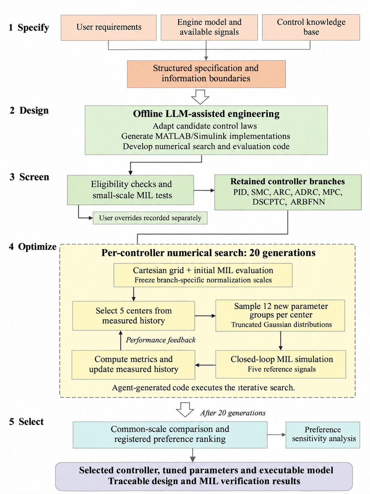

# 0001 绘制论文流程图：示例与实例说明

## 示例图

[打开完整示例图](../../assets/0001/paper-flowchart-example.png)

本图用于复用浅色配色、衬线字体、细边框、阶段标签、空心过渡箭头、虚线循环容器和圆角输出框。布局、阶段数量和研究内容须按新的论文重新安排，不逐像素照搬。

## 本例内容

实例：生成式人工智能辅助航空发动机转速控制器设计、选型与模型在环验证。

1. Specify：用户需求、发动机模型与可用信号、控制知识库形成结构化设计规范和信息边界。
2. Design：离线LLM智能体适配候选控制律，生成或调整MATLAB/Simulink实现，并制定、实现数值搜索和评价代码。
3. Screen：适用性检查和小规模MIL测试后，本例保留PID、SMC、ARC、ADRC、MPC、DSCPTC、ARBFNN七个分支。用户强制保留记录单列；本例七类也均通过技术预试验。
4. Optimize：各分支先建立笛卡尔初始网格、进行五信号MIL评价，再冻结分支尺度并初始化实测历史；进入“选中心→采样→仿真→指标与历史更新”的数值循环。
5. Select：采用共同尺度和已登记的工程偏好比较结果，旁路报告偏好敏感性，交付控制器、参数、可执行模型及可追溯验证资料。

本例预算为每分支20代、5个中心、每中心12个新参数组。每参数组运行5种参考信号。生成的数值代码执行重复更新，不暗示每代重新调用LLM。初始网格评价后的分支尺度与最终跨控制器比较的共同尺度分别管理。

这些阶段、算法和预算仅解释本例，不能变成其他论文的固定要求。最终技术事实应以新任务的原始资料为准。示例图也需要按实际出版用途复核连线与文字。

## 资源与来源

- 入库日期：2026-11-05。
- 示例图来源：用户认可的 `Fig01_Design_and_Verification_Framework_ReferenceStyle_v2.png`；已复制到本skill内，后续查看不依赖原工程或剪贴板文件。
- 本条目没有附加模板，也不需要为其创建空模板。
